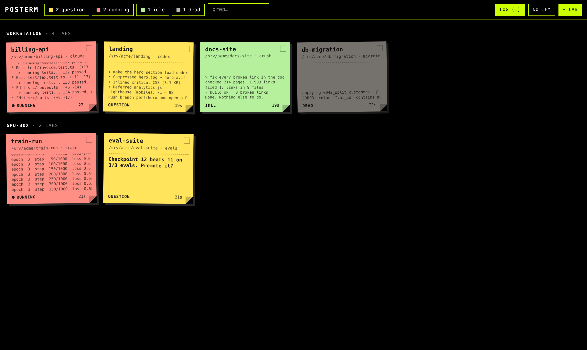
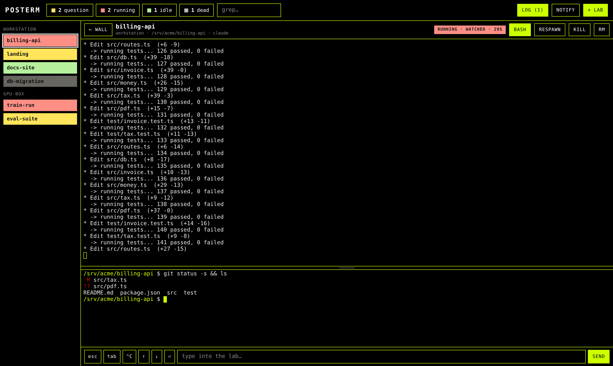
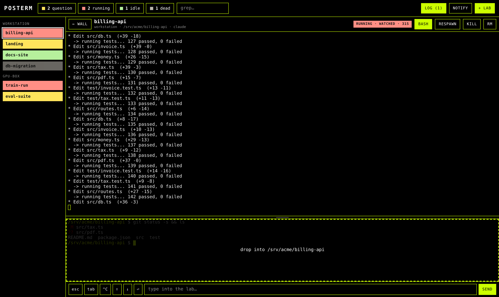
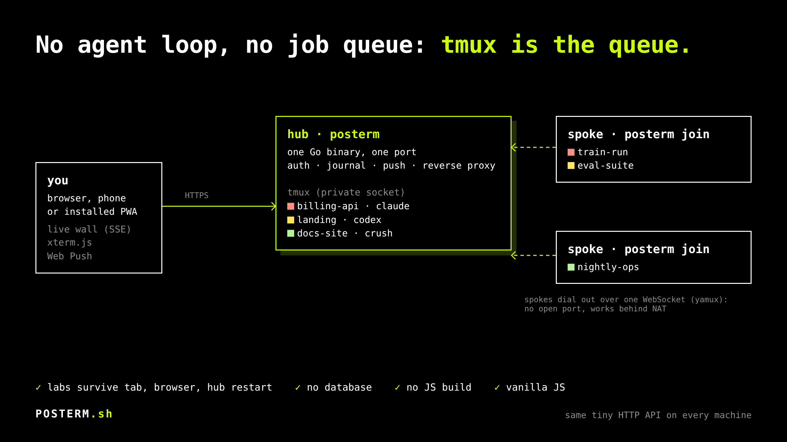

# POSTERM — le mur de labos

[English](README.md) · Français

**Un job d'agent, c'est un terminal qui tourne tout seul. C'est tout. C'est toute l'idée.**

**POSTERM** = post-it + terminal. Un mur de post-its, et chaque post-it est un vrai terminal.

Pas de framework d'agents. Pas de file d'attente. Pas de base de données. Pas
de couche d'orchestration qui « gère » tes agents et finit par te gêner.
`claude`, `codex`, `crush` ou un simple `bash` tournent dans tmux, parce que
tmux a réglé la persistance il y a des décennies. POSTERM les met tous sur un
seul mur, qui se lit en une demi-seconde, depuis ton bureau ou ton téléphone.



Construit par la personne qui s'en sert, tous les jours, matin, midi et soir, depuis
le premier commit. Ce n'est pas une démo qui a grandi : c'est l'outil, et il est
corrigé le jour même où il gêne. L'agent qui a écrit ce README tournait
lui-même dans un labo POSTERM, sur ce mur.

Et franchement : voir dix agents bosser en parallèle, savoir d'un coup d'œil
lequel t'attend, et lui répondre depuis le canapé, ça ne lasse pas.

## Le problème

Lance plus de trois agents de code à la fois et tu connais la suite : une
douzaine d'onglets de terminal, et celui qui attend depuis vingt minutes sur un
`[y/N]` est, évidemment, celui que tu n'as pas regardé.

Donc : chaque job est un **labo**, un dossier plus une commande. Chaque labo est
un post-it. La couleur te dit s'il a besoin de toi. Le reste de l'écran, tu peux
l'ignorer.

| couleur | état       | ce que ça veut dire                                        |
| ------- | ---------- | ---------------------------------------------------------- |
| rouge   | `en cours` | l'écran bouge. Laisse-le bosser.                           |
| jaune   | `question` | silencieux, bloqué sur une invite ou un dialogue. À toi.   |
| vert    | `posé`     | silencieux, rien demandé. Fini, ou en attente d'ordres.    |
| gris    | `éteint`   | plus de processus. Le code de sortie est sur le post-it.   |

(Avec `POSTERM_LANG=en`, ces états s'appellent `running`, `question`, `idle`,
`dead`.)

## Ce que tu as vraiment

**Le mur**
- Chaque post-it montre la fin de son écran en direct, ou la question exacte que
  l'agent a posée. Le titre de l'onglet et le badge de l'appli comptent les
  jaunes.
- Les compteurs d'état sont des filtres. La recherche fouille le nom, le dossier
  et la commande. Les labos sont groupés par machine.
- **Diffusion** : coche des post-its, tape une ligne, chacun la reçoit, Entrée
  comprise. `continue`. `lance les tests`. `commit`. Fait.
- **Journal** : chaque question, chaque labo qui se pose après du vrai travail,
  chaque extinction, avec un compteur de ce qui s'est passé pendant que tu ne
  regardais pas.

**Un labo, ouvert**



- Clique sur un post-it : tu es dans le **vrai terminal**, xterm.js sur tmux.
  Pas une visionneuse de logs, pas une fenêtre de chat. Ferme l'onglet, tue le
  navigateur, redémarre le hub : le job s'en fiche.
- **Sélectionne du texte, un menu s'ouvre là où tu lâches** : copier, ou
  télécharger en `.md`. Un simple glisser sélectionne dans tmux (qui passe le
  texte par OSC 52), Shift+glisser sélectionne dans xterm. Clique ailleurs et
  rien n'est copié.
- Le **rail** liste tous les labos dans leur couleur. Glisse pour réordonner ;
  le mur et le clavier suivent.
- `Ctrl+Tab` / `Ctrl+Shift+Tab` (ou `Alt+PageDown` / `Alt+PageUp`) parcourent
  les labos, `Alt+Q` saute à la prochaine question, `Alt+M` revient au mur.
- **Un bash dans chaque labo**, en bas, dans le dossier du labo, pour le
  `git diff` que tu veux pendant que l'agent bosse. Activable par labo,
  redimensionnable, et il survit exactement comme le labo.

**Dépose des fichiers dessus**



- Glisse des fichiers *ou des dossiers entiers* sur le bash. Ils atterrissent
  dans **son dossier courant**, là où tu as fait `cd`. La cible s'affiche avant
  que tu lâches.
- Les dossiers sont zippés dans le navigateur (deflate ; médias et archives
  stockés tels quels, recompresser des JPEG est une perte de temps pour tout le
  monde), envoyés en un seul flux, décompressés côté serveur. Un `.zip` déposé
  est décompressé dans `<nom>/` et pas gardé.
- Rien n'est écrasé sans demander. `Échap` ou ✕ annule à tout moment, et un
  envoi annulé ou raté est défait : rien d'écrit. `Alt` + dépôt envoie brut,
  sans zip ni décompression.

**Loin du bureau**
- Installe-le comme une appli (PWA). Une **notification push** part quand un
  labo pose une question ou se pose ; là où le navigateur le permet, elle a un
  champ **Répondre** qui tape directement dans le labo. Pas de push pour un labo
  que tu regardes déjà.
- Sur téléphone, une barre de touches te donne `esc`, `tab`, `^C`, les flèches
  et Entrée.

**L'état exact, quand deviner ne suffit pas**

Les couleurs viennent d'une heuristique (plus bas). Pour qu'elles soient
exactes, fais-le dire au labo. Branche ça dans les hooks de ton agent :

```sh
posterm etat question "Supprimer build/ ?"   # jaune, avec le texte sur le post-it
posterm etat pose                            # vert
```

Pas de réseau, pas de jeton : ça écrit un fichier dans `$POSTERM_DATA/etat/`. Le
système de fichiers sert d'IPC. `POSTERM_LAB` et `POSTERM_DATA` sont définis dans
chaque labo. L'état déclaré tient jusqu'à ce que l'écran bouge à nouveau.
(`posterm state question|idle` est l'orthographe anglaise, identique.)

## Une journée sur le mur

- **Le matin.** Tu ouvres le mur. Ce qui a tourné cette nuit est vert, jaune ou
  gris, et le journal raconte ce qui s'est passé pendant que tu dormais. Les
  jaunes d'abord.
- **La journée.** Cinq, dix labos en même temps, sur une machine ou plusieurs.
  Tu ne surveilles plus des onglets : tes yeux vont là où il y a de la couleur.
  Diffuse `lance les tests` à tous les verts, relis le diff dans le bash du
  labo, dépose-lui le fichier de spec.
- **En vadrouille.** Le téléphone vibre : un labo a une question. Tu réponds
  depuis la notification, sans rouvrir l'ordi.
- **Le soir.** Lance les longs, ferme le navigateur. Les labos vivent dans tmux,
  sur la machine, pas dans ton onglet ; ils seront là demain.

## Un binaire, cinq visages

```
posterm                       le hub : le mur web + les labos de cette machine
posterm join [url-du-hub]     un rayon : publie les labos de cette machine au hub
posterm lab <dossier> [cmd…]  lance un labo ici, depuis le shell
posterm etat <question|pose> [texte…]   depuis un labo : dire où il en est
posterm spoke add|revoke|list [nom]     sur le hub : un jeton de jonction par machine
```

## Démarrer

```sh
curl -fsSL https://posterm.sh/install | sh
```

Sous Linux, il va jusqu'au bout :

1. le binaire statique dans `~/.local/bin` (`/usr/local/bin` en root) ;
2. tmux via ton gestionnaire de paquets s'il manque ou date d'avant la 3.1 (il
   demande d'abord, et passe par sudo si tu n'es pas root) ;
3. `~/.local/bin` dans ton PATH (une ligne marquée `# POSTERM` dans le rc de ton
   shell) ;
4. `~/.posterm/.env`, écrit une seule fois, en français si ton `$LANG` l'est ;
5. le hub en service systemd (service utilisateur, ou système en root) qui
   démarre au boot et revient après un plantage. Sans systemd : lancé en
   arrière-plan ;
6. l'adresse et le jeton, affichés.

Testé sur Ubuntu 22.04 et 24.04, Debian 12, Arch, Fedora et Alpine, en
utilisateur comme en root. Ubuntu 20.04 livre tmux 3.0 : trop vieux, et le
script le dit. Sur macOS, il lance le paquet Mac ci-dessous. Chaque
téléchargement est vérifié contre le `SHA256SUMS` de la version, et
`SHA256SUMS` contre la signature du projet (`ssh-keygen -Y`, la clé est dans le
script). Relance-le
pour mettre à jour (les labos continuent de tourner). Les options se mettent
après `sh -s --` : `--uninstall`, `--yes` (aucune question), `--no-service`. Un
`posterm.service` que tu as écrit toi-même n'est jamais touché. Lis-le avant :
[chaque étape est commentée](https://posterm.sh/install).

Sur une machine distante, le hub n'écoute que sur `127.0.0.1`. Depuis ton
ordinateur : `ssh -NL 8206:127.0.0.1:8206 toi@machine`, puis ouvre
`http://127.0.0.1:8206`. Pour un domaine avec TLS, voir
[Déployer le hub](#déployer-le-hub).

Depuis les sources, il te faut Go et `tmux` >= 3.1. C'est toute la liste des
dépendances.

```sh
cp .env.example .env   # puis l'éditer : titre, langue (POSTERM_LANG=fr), adresse, dossier de données
bin/build.sh           # gofmt + vet, binaire statique, sauvegarde l'ancien
./posterm                # http://127.0.0.1:8206
```

Le premier démarrage génère un jeton d'accès et un jeton de jonction pour les
rayons, les affiche et les garde dans `$POSTERM_DATA/secrets/`. Ouvre la page,
colle le jeton d'accès, clique **+ labo** : choisis un dossier (avec
complétion) et une commande (les récentes d'abord).

`bin/build.sh` garde des sauvegardes horodatées dans `bin/backup/` (7 jours) et
finit par `systemctl restart posterm`. Pas en service ? Supprime cette ligne.

### Sur un Mac, sans compilateur

`macos/build.sh` fabrique `macos/dist/POSTERM-macos.zip`. La personne qui le reçoit :

1. le dézippe et double-clique `install.command` : il installe tmux (Homebrew),
   met `~/.local/bin/posterm` en place, lance le hub à chaque session
   (LaunchAgent) et ouvre Safari avec le jeton déjà dans le presse-papier ;
2. colle le jeton ;
3. fait **Fichier → Ajouter au Dock**. C'est l'appli : sa fenêtre, son icône,
   ses notifications.

Les labos survivent aux mises à jour et aux fenêtres fermées,
`uninstall.command` demande avant de toucher à quoi que ce soit d'important.
Pas à pas et pièges (macOS protège Bureau/Documents) :
[`macos/README.md`](macos/README.md).

## Plus de machines

Le même binaire, partout :

```sh
# sur le hub, une fois par machine (sous l'utilisateur qui lance le hub) :
posterm spoke add portable        # affiche le jeton de portable, une seule fois
# sur le portable :
POSTERM_NAME=portable POSTERM_TOKEN=<jeton de portable> posterm join https://hub.example.org
```

`posterm spoke revoke portable` le coupe dans la seconde ; `posterm spoke list`
montre qui a un jeton. Un jeton de rayon ouvre `/join` pour ce nom, et rien
d'autre.

Le rayon appelle **vers l'extérieur** : un WebSocket vers le hub. Aucun port à
ouvrir, le NAT et les box ne sont pas ton problème. Dans le tunnel (yamux), le
hub parle du HTTP tout bête au rayon, parce que chaque machine expose exactement
la même petite API et que le hub n'est qu'un reverse proxy vers `/m/<machine>/…`.
Lance les labos d'un rayon depuis le mur (choisis la machine) ou directement
là-bas avec `posterm lab`.



## Comment un labo passe au jaune

Une fois par seconde, le moteur regarde tmux :

1. **l'écran a bougé** il y a moins de `POSTERM_QUIET` secondes → *en cours* ;
2. sinon, si la **ligne du curseur** ressemble à une invite (`[y/N]`,
   `password`, finit par `?`…) ou si l'écran montre un **dialogue** connu (regex
   `POSTERM_QUESTION`) → *question* ;
3. sinon → *posé*.

Oui, c'est une heuristique. Une commande qui reste longtemps muette a l'air
posée, et les dialogues intégrés (crush, Claude Code) peuvent demander un
réglage via `POSTERM_QUESTION`. Si ça te dérange, utilise `posterm etat` dans les
hooks et arrête de deviner.

## Configuration

Variables d'environnement, ou un `.env` dans le dossier de travail, ou, s'il
n'y en a pas, `~/.posterm/.env` (celui qu'écrivent les installeurs). Modèle
commenté : `.env.example` ; l'environnement réel l'emporte. Tout ce qui
appartient à *une* installation (nom, langue, domaine, jeton, noms de machines,
chemins) vit là. Jamais dans le code, jamais dans ce dépôt.

| variable         | défaut              | rôle                                                          |
| ---------------- | ------------------- | ------------------------------------------------------------- |
| `POSTERM_TITLE`    | `POSTERM`          | le nom affiché partout : page, logo, appli, notifications     |
| `POSTERM_LANG`     | `en`                | `en` ou `fr` : interface, push, CLI, logs, erreurs de l'API   |
| `POSTERM_USER`     | —                   | lancé en root, posterm devient cet utilisateur (les labos aussi)|
| `POSTERM_GROUP`    | groupe de l'utilisateur | groupe principal correspondant                            |
| `POSTERM_ADDR`     | `127.0.0.1:8206`    | adresse d'écoute du hub                                       |
| `POSTERM_TOKEN`    | généré              | hub : le jeton de l'opérateur (web, API) ; rayon : le jeton de jonction du hub |
| `POSTERM_JOIN_TOKEN` | généré            | hub : le jeton de jonction commun, pour les rayons sans le leur (`posterm spoke add`) |
| `POSTERM_INSECURE` | —                   | `1` : laisse `posterm join` envoyer son jeton à un hub distant sans TLS |
| `POSTERM_HUB`      | —                   | URL du hub, pour `posterm join`                                 |
| `POSTERM_NAME`     | nom d'hôte          | le nom de la machine sur le mur                               |
| `POSTERM_DATA`     | `~/.posterm`          | registre, journal, socket tmux, abonnements push, `secrets/`  |
| `POSTERM_QUIET`    | `3`                 | secondes de silence avant qu'un labo ne soit plus « en cours »|
| `POSTERM_QUESTION` | `src/engine.go`     | regex des dialogues qui valent question (remplace le défaut)  |

Chaque mot que dit le programme vient de `src/web/i18n/<langue>.json`, les mêmes
fichiers pour Go, la page et le navigateur. Ajouter une langue, c'est ajouter un
fichier.

## Déployer le hub

`config/` contient trois fichiers de référence : `create-usergroup.sh`
(l'utilisateur des labos), `posterm.service` (systemd) et `Caddyfile.example` (un
reverse proxy verrouillé : liste d'IP autorisées, TLS 1.3, en-têtes stricts,
certificats clients en option). WebSocket et SSE traversent Caddy sans
encombre. Si ton proxy plafonne la taille des requêtes, lève le plafond pour la
seule route d'envoi : `docs/caddy.md`.

Les exemples supposent que posterm vit dans `/opt/posterm` (binaire, `.env`,
`data/`) et les projets sous `/srv`. Adapte les chemins, `posterm.service`
compris.

En service systemd, **`KillMode=process`** n'est pas optionnel. Sans lui,
redémarrer le hub tue le serveur tmux, et tous les labos avec.

### Sous quel utilisateur tournent les labos

Les labos tournent sous l'identité du hub, et le hub sous celle que dit le
`.env` (`POSTERM_USER` / `POSTERM_GROUP`). Lancé en root (systemd, sudo), posterm
prend cette identité avant de toucher à quoi que ce soit et lui confie son
dossier de données. Les labos héritent des groupes, du `HOME` et du shell de
l'utilisateur (`/bin/bash` si le compte n'en a pas, comme `www-data`). Laisse
les deux vides et posterm reste celui qui l'a lancé.

- **root** : les agents peuvent tout faire (`systemctl`, `/etc`, Caddy…). Mais
  le bac à sable de codex est un *user namespace*, et là-dedans root perd ses
  droits sur les fichiers des autres utilisateurs : si les projets
  appartiennent à `www-data`, codex ne peut écrire que dans `/tmp`. Solution :
  `codex -s danger-full-access`.
- **un utilisateur dédié** (`posterm`) : de simples permissions Unix, dans le bac
  à sable aussi. Rien qui demande root, en revanche : garde ça pour toi, ou
  accorde-le commande par commande avec sudo (plus bas).
- **www-data** : les projets lui appartiennent déjà. Mais c'est aussi
  l'utilisateur de ton serveur web, et maintenant il fait tourner des agents.
  À toi de voir.

Un serveur tmux appartient à un seul utilisateur. Changer d'identité impose
d'arrêter les labos en cours : le hub refuse de démarrer tant que le serveur
tmux d'un autre utilisateur tient la socket, et t'indique la commande à lancer.

Passer en `posterm:posterm` :

```sh
# 1. utilisateur et groupe (compte système verrouillé, vrai shell, HOME privé,
#    groupe supplémentaire www-data, umask 002). Idempotent.
config/create-usergroup.sh

# 2. projets : à posterm, www-data garde l'accès par le groupe
for p in /srv/projet-a /srv/projet-b; do
  chown -R posterm:www-data "$p"
  chmod -R g+w "$p"
  find "$p" -type d -exec chmod g+s {} +   # les nouveaux fichiers restent dans le groupe www-data
done

# 3. arrêter l'ancien hub ET son serveur tmux (ça tue les labos en cours)
tmux -S /opt/posterm/data/tmux.sock kill-server

# 4. dans le .env : POSTERM_USER=posterm et POSTERM_GROUP=posterm. Le .env reste à root :
#    le hub le lit avant de changer d'identité, et les labos n'ont pas à lire
#    le jeton.
chown root:root /opt/posterm/.env && chmod 600 /opt/posterm/.env
#    puis le service
cp /opt/posterm/config/posterm.service /etc/systemd/system/
systemctl daemon-reload && systemctl enable --now posterm
journalctl -u posterm -f
```

Ensuite, ouvre un labo `bash` sur le mur (il tourne désormais en `posterm`) et
installe et connecte les agents là-dedans (`claude`, `codex login`…). Les
binaires et connexions de root (`/root/.local`, `/root/.nvm`, `~/.codex`,
`~/.claude`) sont hors de portée de posterm ; copie les réglages que tu veux, par
exemple `/root/.codex/config.toml`. Puis relance les labos : `labs.json` est
gardé, les conversations des agents non (elles restent sous `/root`).

`posterm lab …` lancé en root depuis `/opt/posterm` prend aussi l'identité du
`.env`. Pour regarder un labo depuis la machine elle-même :
`sudo -u posterm tmux -S /opt/posterm/data/tmux.sock attach -t <id>`.
Tant que tu y es attaché, ce labo n'envoie pas de push : tu le regardes déjà.

Pour rendre quelques pouvoirs de root à un utilisateur dédié, un
`/etc/sudoers.d/posterm` (à éditer avec `visudo -f`) qui autorise exactement les
commandes voulues :

```
posterm ALL=(root) NOPASSWD: /usr/bin/systemctl restart projet-a.service, /usr/bin/systemctl reload caddy
```

## Sécurité

Le hub distribue un shell sur chaque machine connectée. C'est son travail. Il
est fait pour un seul opérateur, et ne prétend pas le contraire.

- Un seul jeton d'opérateur, comparé en temps constant, cookie `HttpOnly` pour
  les navigateurs. Pas de jeton, pas de données : une page vide et une case de
  connexion.
- Les connexions ratées sont limitées (cinq par client, trente pour le hub,
  puis `429`).
- Chaque rayon se joint avec son propre jeton (`posterm spoke add <nom>`), qui
  ouvre `/join` pour ce nom et rien d'autre, et `posterm join` refuse de
  l'envoyer en clair à un hub distant.
- Chaque action passée par l'API (création, lancement, arrêt, suppression,
  touches, envois) finit dans le journal, jamais le texte tapé.
- Les versions sont signées ; l'installeur refuse tout le reste. À la main :
  `ssh-keygen -Y verify -f site/allowed_signers -I posterm-release -n posterm-release -s SHA256SUMS.sig < SHA256SUMS`,
  puis `sha256sum -c SHA256SUMS`.
- Une faille ? [SECURITY.md](SECURITY.md) : signale-la en privé.
- **Les labos ne voient jamais les secrets du hub.** Ce sont des agents, ils
  lisent ce que des inconnus ont écrit, et une injection de prompt tient en un
  paragraphe.
  - Rien du `.env` et aucun réglage `POSTERM_*` n'arrive dans
    l'environnement d'un labo.
  - Les jetons et les clés push vivent dans `$POSTERM_DATA/secrets/`, réservé
    à root, lus avant que le hub ne lâche ses privilèges, gardés en mémoire
    ensuite.
  - Le dossier de données reste à root, avec le sticky bit : un labo ne peut
    pas écarter `secrets/` pour y glisser le sien.
  - C'est vrai quand le hub démarre en root avec un `POSTERM_USER`. Démarré
    sous l'utilisateur des labos, il n'y a plus personne à qui les cacher.
- Mise à jour depuis 0.1.0 : les labos déjà lancés gardent l'environnement
  qu'ils avaient. Change le jeton (un nouveau `POSTERM_TOKEN`, ou
  `rm $POSTERM_DATA/secrets/token` ; puis redémarre) et relance les labos.
- Toute requête avec un `Origin` étranger est refusée (CSRF, détournement de
  WebSocket).
- Le hub écoute sur `127.0.0.1` par défaut. TLS est le travail du reverse proxy,
  la liste d'IP autorisées aussi.
- Un rayon n'écoute sur rien.
- Les envois sont confinés à leur dossier cible : le serveur n'accepte que le
  dossier courant du bash, ou un dossier qu'il a lui-même donné pour ce labo
  dans les 15 dernières minutes. Chaque chemin, et chaque entrée de chaque zip,
  est vérifié avant d'écrire le moindre octet.
- Les labos tournent sous l'utilisateur du hub (`POSTERM_USER`). Fais-en un
  utilisateur dédié.

## Feuille de route

La 1.0 est une promesse, pas une liste de fonctionnalités : on peut lui
confier ses agents, une mise à jour ne casse rien, et ce qui est documenté ne
bouge pas sans version majeure. Chaque étape a son
[jalon](https://github.com/l3dlp/posterm.sh/milestones) et une issue par chantier.

| phase                         | statut                                                                                       |
| ----------------------------- | -------------------------------------------------------------------------------------------- |
| 0 — binaire unique, auth      | fait : un binaire, un port ; jeton + cookie au lieu d'une liste d'IP                         |
| 1 — jobs durables, journal    | fait : job = session tmux ; `journal.jsonl` en ajout seul (les transitions, pas chaque octet) |
| 2 — l'humain dans la boucle   | fait : l'état `question`, `posterm etat`, réponse depuis le mur, la diffusion ou le push       |
| 3 — Web Push, badge, boîte    | fait : VAPID, badge de la PWA = nombre de questions, journal « depuis ta dernière visite »   |
| 7 — tableau de bord, PWA      | fait : le mur, installable                                                                   |
| 0.1.1 — secrets               | fait : les labos ne voient jamais les jetons ni les clés push du hub ; jeton de jonction pour les rayons |
| 0.2 — confiance               | [faite](https://github.com/l3dlp/posterm.sh/milestone/1) : jetons de jonction par machine, releases signées, limite des connexions, journal des actions, tests du tunnel, fuzzing, SECURITY.md |
| 0.3 — événements              | [prochaine](https://github.com/l3dlp/posterm.sh/milestone/2) : états lus via les hooks de tmux au lieu d'un sondage à 1 Hz, arrêt propre, reconnexions, relance au démarrage |
| 0.4 — vrai matériel           | [prévue](https://github.com/l3dlp/posterm.sh/milestone/3) : un vrai Mac, de vrais téléphones, CI Linux amd64/arm64 et macOS, envois au-delà de 4 Go |
| 1.0 — contrats                | [prévue](https://github.com/l3dlp/posterm.sh/milestone/4) : API, CLI, `posterm state` et format des données documentés, migrations, recettes de hooks, `posterm doctor` |
| 4 — chat unifié               | non. On parle aux agents dans leur terminal. Les terminaux servent à ça.                     |
| 5 — wiki comme mémoire        | non                                                                                          |
| 6 — posterm.do comme outil      | non                                                                                          |

## Limites connues

- Après un **redémarrage de la machine**, les labos sont toujours sur le mur
  mais éteints. Un clic sur « relancer » et la commande repart de zéro.
- Les budgets (tours, tokens) sont l'affaire de l'agent, pas la nôtre.
- Un labo sans commande ouvre un shell de connexion, qui atterrit là où ton
  profil shell l'envoie. Donne-lui une commande et le dossier du labo est
  garanti.
- Deux langues pour l'instant : anglais et français.
- Le service worker (affichage des notifications, bouton Répondre) n'a pas
  encore été testé sur un vrai téléphone ; l'envoi côté serveur est vérifié.
- Les dossiers sont zippés sans zip64 : au-delà de 4 Go, `Alt` + dépôt.
- `journal.jsonl` est archivé au démarrage au-delà de 4 Mo dans
  `journal.1.jsonl`, une seule génération gardée. Au-delà, l'historique part.
- Le paquet Mac est testé sur Linux avec macOS simulé. Pas encore sur un vrai
  Mac : Gatekeeper, launchd et le push dans l'appli du Dock restent à vérifier.

## Organisation

```
README.fr.md     ce fichier ; README.md est la version anglaise (les garder synchrones)
go.mod, go.sum   le module Go (les seuls fichiers Go à la racine)
.env.example     modèle de .env (le vrai .env est propre à chaque installation, pas versionné)
src/main.go      les quatre commandes, lecture du .env
src/i18n.go      POSTERM_LANG, T() : les dictionnaires, pour Go et le navigateur
src/user.go      l'identité des labos (POSTERM_USER / POSTERM_GROUP)
src/secrets.go   jetons et clés push, hors de portée des labos
src/spokes.go    un jeton de jonction par machine (posterm spoke)
src/audit.go     limite des connexions, journal des actions de l'opérateur
src/engine.go    une machine : registre, tmux, détection d'état, API, terminaux, envois
src/engine_test.go  go test ./src : confinement des chemins, zips, cibles d'envoi, config
src/hub.go       le hub : jeton, tunnels des rayons, journal, flux SSE, push
src/web/         le mur : HTML/CSS/JS sans build, xterm.js embarqué, intégré au binaire
src/web/i18n/    en.json, fr.json : chaque texte affiché
bin/build.sh     compilation (sauvegardes horodatées dans bin/backup/)
bin/release.sh   les fichiers d'une version : 4 binaires statiques, le zip Mac, SHA256SUMS signé
macos/           le paquet Mac : build.sh -> zip, install/uninstall.command, guide
config/          create-usergroup.sh, posterm.service, Caddyfile.example
docs/design.md   pourquoi c'est construit ainsi : chaque choix, ce qu'on a refusé, ce que ça coûte (en anglais)
docs/caddy.md    lever la limite de taille de Caddy pour les envois
docs/img/        captures d'écran (labos de démo, rien de réel)
docs/x/          visuels pour les réseaux : sources HTML, PNG, render.cjs
site/            posterm.sh : pages statiques (en, fr), la page du doc technique, le script d'install ;
                 site/build.sh régénère, site/deploy.sh publie (POSTERM_SITE_DIR)
LICENSE          MIT
data/            POSTERM_DATA si le .env le met là (registre, journal, socket tmux), pas versionné
```

## Licence

MIT — © 2026 L3DLP. Voir [LICENSE](LICENSE).
